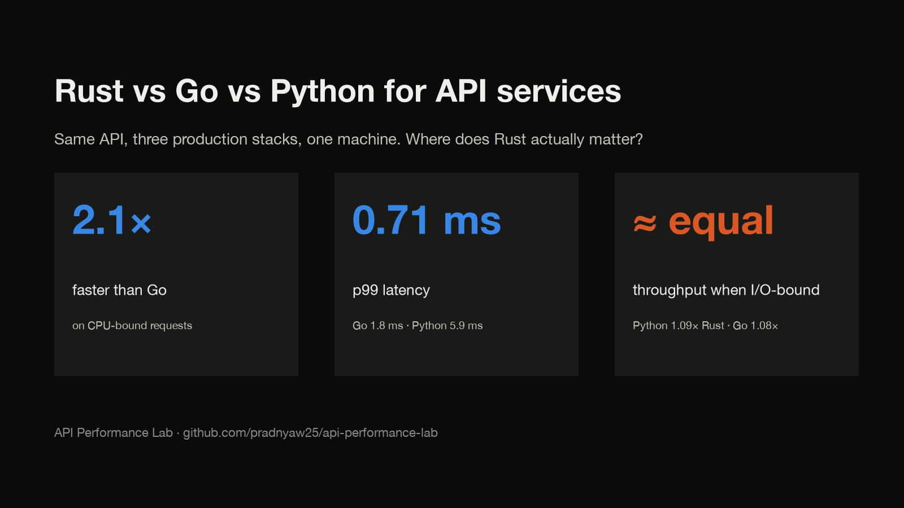
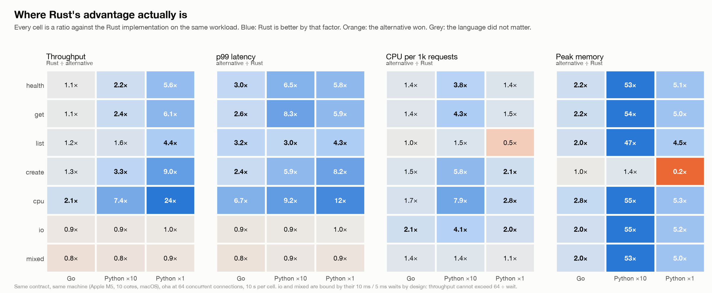
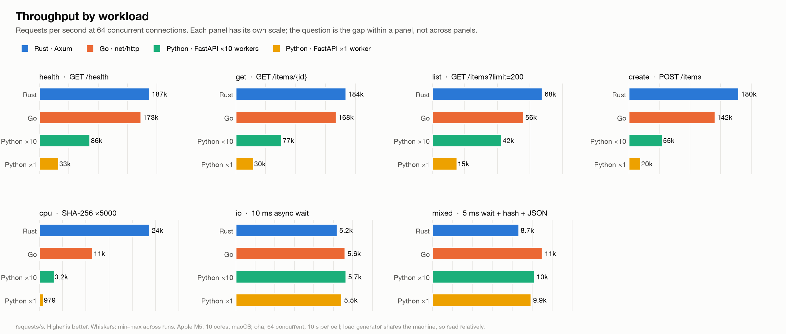
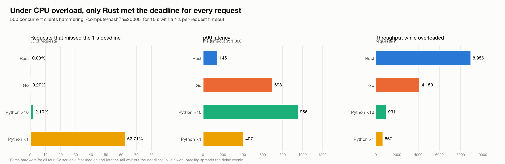
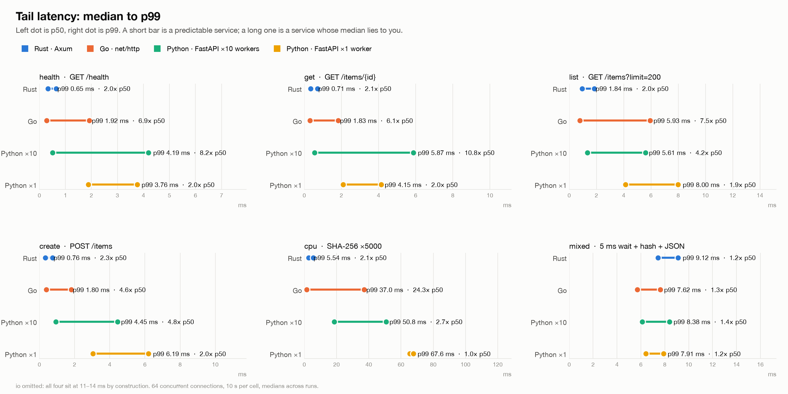
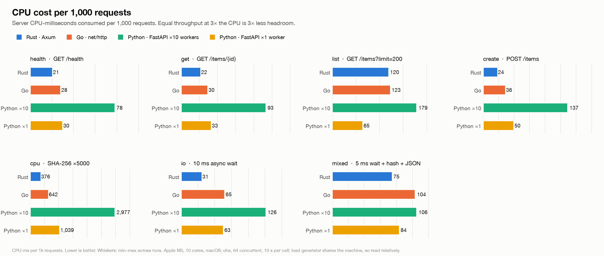
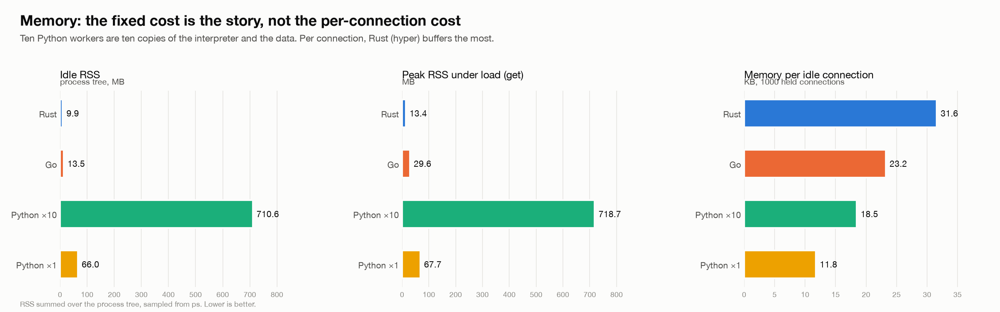
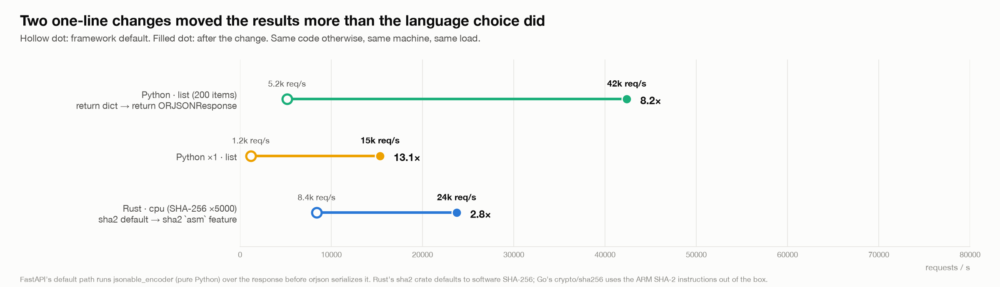
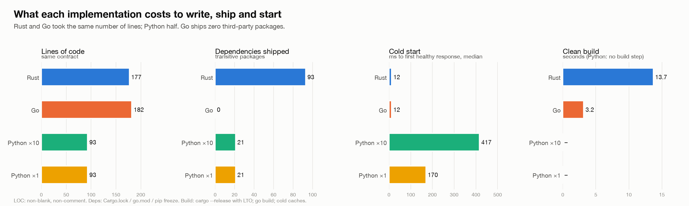

# I built the same API in Rust, Go and Python. Here's where Rust actually mattered.

### Seven workloads, nine metrics, three production stacks, and two one-line changes that moved the results more than the language did.

Everyone already knows Rust is faster than Python. That is not a useful fact. The useful questions are *where* it is faster, *by how much*, *what it costs to get there*, and whether the workload your service actually runs is one of the places where it matters.

So I built the same API three times, with each ecosystem's production stack, and measured it the way I would want a vendor to measure it: with the hypotheses written down before the runs, a contract test that refuses to benchmark an implementation that behaves differently, and the cost side (memory, CPU per request, lines of code, dependencies, cold start) next to the speed side.

Here is what came out, including the parts that surprised me.

## The setup

**Same contract, three implementations.**

| | Stack | Lines of code |
|---|---|---|
| Rust | Axum 0.8 on Tokio, serde_json | 177 |
| Go | Standard library `net/http` (1.22 routing), `encoding/json` | 182 |
| Python | FastAPI on Uvicorn with uvloop, httptools and orjson | 93 |

Python runs two ways: ten Uvicorn workers (one per core, the production deployment model) and a single worker, so the cost of scaling Python is visible rather than hidden.

**Seven endpoints, each isolating one thing an API service spends time on:**

- `health`: the framework and HTTP stack floor
- `get`: routing, a shared-state read, a small JSON encode
- `list`: serializing 200 objects
- `create`: JSON decode, validation, a write under a lock
- `cpu`: 5,000 rounds of SHA-256 on the request path, no I/O
- `io`: a 10 ms async wait, no CPU
- `mixed`: a 5 ms simulated database wait plus a little hashing and JSON

**One shared contract test** (plain-Python, stdlib only) runs against every implementation before the benchmark will touch it. If the responses differ, the numbers are not comparable, so the harness refuses.

**Load:** `oha` at 64 concurrent connections, 10 seconds per cell after a 3-second warm-up, fresh process per scenario. Apple M5, 10 cores, macOS. The load generator shares the machine with the service, which understates every absolute number equally; read everything as relative.

Everything is in the repo: [github.com/pradnyaw25/api-performance-lab](https://github.com/pradnyaw25/api-performance-lab).

## The one chart

Every cell is a ratio against the Rust implementation on the same workload. Blue means Rust is better by that factor, orange means the alternative won, grey means the language did not matter.

Read it by rows and the pattern is obvious: the bottom two rows (`io`, `mixed`) are grey or orange everywhere except the CPU and memory columns. When the request is waiting on something, the language you wrote it in does not decide how fast it goes. It decides what it costs while it waits.

## Where Rust wins

### 1. CPU on the request path

On the `cpu` endpoint Rust served 23,700 requests per second. Go served 11,500, ten-worker Python 3,200, single-worker Python 979. That is 2× Go and 7× Python with all ten cores.

The number that matters more than throughput is what happens when you push past it:

With 500 concurrent clients hammering a heavier hash and a 1-second per-request timeout, Rust missed the deadline on zero requests with a p99 of 145 ms. Go missed 0.2% with a p99 of 698 ms. Ten-worker Python missed 2.1%, single-worker Python missed 63%.

The detail I find most interesting is that Go's *median* under overload (21 ms) beat Rust's (51 ms) while its p99 was five times worse. Go's scheduler serves some requests fast and lets others wait out the deadline. Tokio's work-stealing spreads the pain evenly, so nobody times out. If you have an SLO, evenly is what you want.

### 2. Tail latency

Left dot is p50, right dot is p99. On a simple lookup, Rust's p99 is 0.71 ms and its p99 is 2.1× its median. Go's p99 is 1.83 ms at 6× its median. Ten-worker Python's p99 is 5.87 ms at 11× its median.

Go's p95 is where its garbage collector becomes visible. On the CPU endpoint the gap between Go's median and its p99 opens to 24×. Rust's stays at 2×. If your SLO is written against p99 rather than the median, Rust is the only one of the three whose tail stays flat.

### 3. Density

Throughput is half the story; the other half is what each request costs in CPU. On the lookup endpoint Rust spends 22 ms of CPU per 1,000 requests. Go spends 30. Ten-worker Python spends 93. Equal throughput at 3× the CPU is not equal performance; it is 3× less headroom.

Idle memory: Rust 9.9 MB, Go 13.5 MB, single-worker Python 66 MB, ten-worker Python 710 MB. Across a fleet, that is the bill.

## Where Rust does not win

**I/O-bound endpoints.** On `io`, all four implementations land between 5,200 and 5,650 requests per second, within 8%, with p99 between 12.5 and 13.6 ms. Rust is actually last. Tokio's `sleep(10 ms)` completes in 12.3 ms on this macOS build even with a single connection, while Go and uvloop sleep for 11.3 ms. If your service is "call the database and return the result", Rust buys you 2 to 4× less CPU and 2 to 50× less memory while you wait. It does not buy you speed.

**Serialization.** Rust is 1.2× Go and 1.6× tuned Python on the 200-item list. Not a reason to choose it on its own.

**Memory per connection.** This one inverted my hypothesis. Holding 1,000 idle keep-alive connections cost Rust 31.6 KB each, Go 23.2 KB, Python 18.5 KB. Hyper's per-connection buffers are the largest of the three. For a 100,000-connection streaming fan-out that is 3.2 GB versus 2.3 GB versus 1.9 GB, which is to say none of them is the bottleneck; the fixed cost is.

## The two one-line changes

I kept the first run, with every framework at its defaults, in the repo on purpose, because the gap between it and the second run is a result.

**FastAPI.** In the baseline, Python's `list` endpoint was 14× slower than Rust and burned 1.7 ms of CPU per request. That is not orjson being slow. It is FastAPI running its pure-Python `jsonable_encoder` over 200 dicts before the response class serializes them. Returning `ORJSONResponse(...)` directly from the handler skips that pass. One line per handler took the gap from 14× to 1.6× and the CPU from 1.7 ms to 0.18 ms. If you run FastAPI in production and have never checked which path your responses take, check.

**Rust.** In the baseline, Rust was *slower than Go* on the CPU endpoint: 8,400 requests per second against 14,700. Go's standard-library `crypto/sha256` uses the ARM SHA-2 instructions out of the box. Rust's `sha2` crate defaults to software. Enabling its `asm` feature tripled Rust's hashing throughput with an identical digest. The language sets the ceiling; the library decides whether you reach it.

## Things I did not expect

**Ten-worker Python has no shared memory.** The contract test found this before the benchmark did: an item created with a POST on one Uvicorn worker is a 404 on the other nine (1 hit in 10). Python's only route to all ten cores is ten processes, which means ten copies of every in-memory structure and no shared state without Redis or a database round-trip that Rust and Go do not need for the same feature. This is the biggest practical difference in the study and it is architectural, not a benchmark number.

**Nobody has a latency hangover.** After a 5-second spike at 256 concurrency, the first latency probe was back at the pre-spike level for all four. Memory is a different story: Rust and Python kept 100% of the spike's growth after 10 seconds idle (allocators keep their pages), Go gave back 28% (its scavenger ran). In absolute terms the growth was 13 MB for Rust and 23 MB for Go, so this matters for density, not for correctness.

**Python's per-request CPU is close to Go's.** Single-worker Python spends 30 ms of CPU per 1,000 health checks; Go spends 28; Rust 21. uvloop, httptools and orjson are C, and the Python in the request path is thin. The expense is scaling: at ten workers the same code costs 78 ms per 1,000, because ten processes contend for ten cores with each other and with the load generator.

**Same contract, different error shapes.** A non-numeric path id is a 400 with a plain-text message from Axum, a 400 JSON object from Go (because I wrote it), and a 422 with a Pydantic error array from FastAPI. Go is the only one where every byte of the error surface is yours.

## What it costs

Rust and Go took the same number of lines for the same contract: 177 and 182. Python took 93. Rust ships 93 transitive crates; Go ships zero; Python 21 packages. A clean release build is 13.7 s for Rust (LTO on) and 3.2 s for Go. Cold start to first healthy response: 12 ms for Rust, 12 ms for Go, 170 ms for one Python worker, 417 ms for ten.

Go is the honest competitor in this study. It reaches within 10 to 25% of Rust on everything except CPU-bound work and tail latency, with zero dependencies, a 3-second build and the same line count.

## So what should you pick?

- **Your service computes on the request path** (hashing, compression, parsing, scoring, anything that saturates a core): Rust. 2× Go, 7× Python, and the only one that met the deadline for every request under overload.
- **Your SLO is on p99, not on the median**: Rust. It is the only one of the three whose tail stays near 2× its median under load.
- **Your service is mostly waiting on a database or another service**: the language does not decide your latency. Pick for the team, then pay the memory and CPU bill, which is roughly 2× for Go and 50× for ten-worker Python relative to Rust.
- **You need shared in-memory state across all cores**: Rust or Go. Python will need Redis for what the other two get from a mutex.
- **You want Rust's density without Rust's dependency graph and build times**: Go gets you most of the way.

## Caveats, because this is a benchmark

One machine, with the load generator sharing the cores. 10-second windows. macOS, where `somaxconn` is 128 and Tokio's timer behaves differently from Linux. An in-memory store instead of a database. Memory sampled from `ps` four times a second. The numbers in this article are medians across four full runs with the spread in the repo's report; a Linux box with a separate load generator would change the absolute numbers and, I expect, none of the rankings. Phase 2 is the same contract on PostgreSQL, where driver and pool quality start to dominate and the gaps should narrow again.

The repo has every raw `oha` JSON, the harness, and both runs: [github.com/pradnyaw25/api-performance-lab](https://github.com/pradnyaw25/api-performance-lab). If you think a configuration is unfair to your favourite language, open an issue. That is what the contract test is for.
