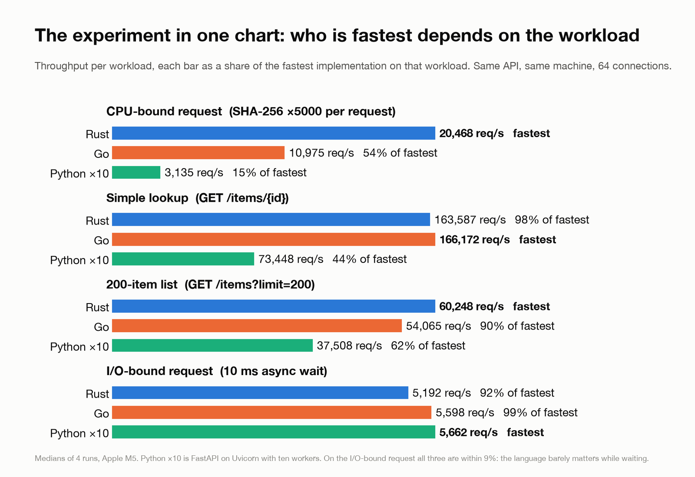
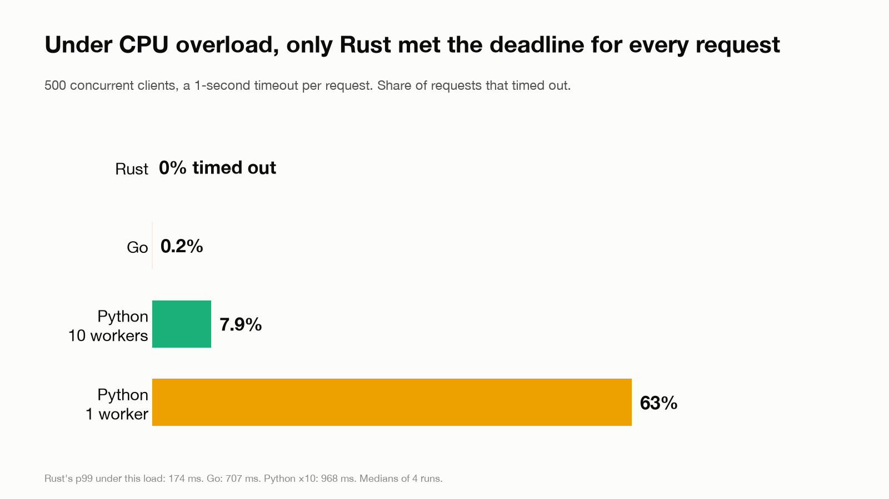
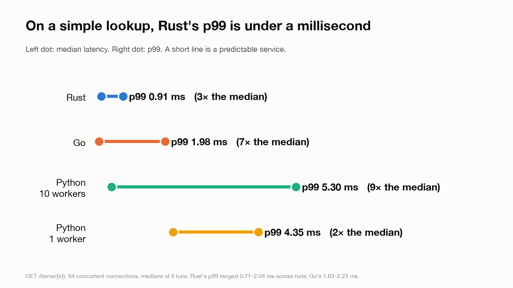
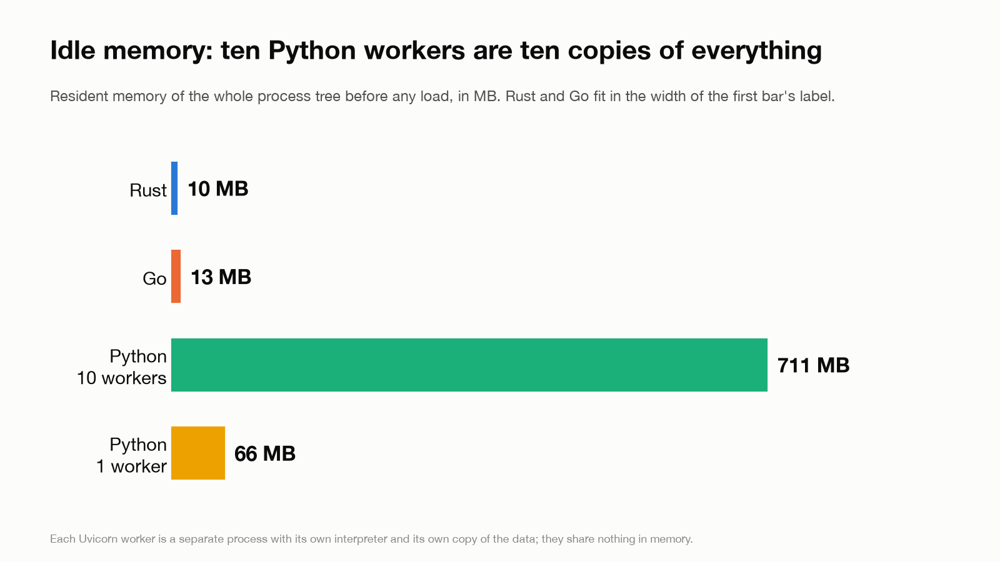
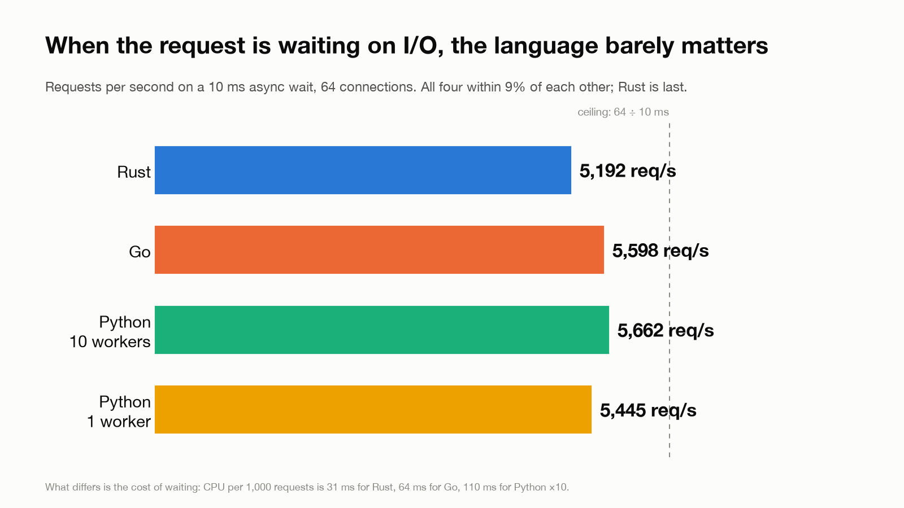
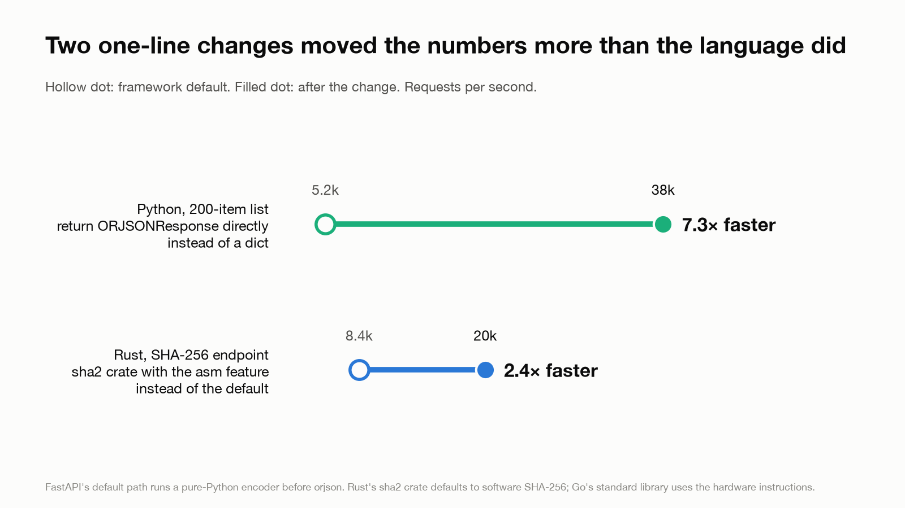

# Benchmarking API Performance: Python vs Go vs Rust

<!-- Medium: upload the six PNGs from content/charts/simple/ at each image marker; Medium does not play GIFs reliably. Cover image: content/charts/00-social-card.png -->

### Same API, three production stacks, nine metrics. Where Rust actually matters, and where it doesn't. A small experiment inspired by Anthropic's Rust migration.

Last week Anthropic published [Migrating our Messages API to Rust](https://www.anthropic.com/research/migrating-api-to-rust): about 70% less CPU per request and more than 80% less memory after rewriting their API from Python to Rust. Those are production numbers from a very large service.

I wanted to know the *shape* of that gain. Which requests get faster? By how much? Which parts are the language, which are the runtime, and which are a library choice? Those questions can be answered on one laptop, with everything else held constant.

So I built the same API three times: Rust with Axum, Go with the standard library, Python with FastAPI on Uvicorn (uvloop, httptools, orjson). Python runs two ways: one worker, which has the same one-process, one-store, one-lock semantics as Rust and Go and is the like-for-like comparison, and ten workers, which is how it is actually deployed and which has ten separate stores. Seven endpoints, each isolating one kind of work. A shared test that refuses to benchmark anything that behaves differently. Nine metrics, 4 full runs, medians below.

**One thing first:** this is a lab benchmark on a laptop, not production traffic. It cannot tell you what a migration like Anthropic's would yield. It can tell you *where* the differences come from.

## The experiment in one chart

Each group is one workload; each bar is that language's throughput as a share of the fastest on that workload, with the real requests per second on it. On CPU-bound work Rust is well ahead. On a simple lookup Rust and Go are tied. On a request that is *waiting* on something, all three are within 9% and Rust is last. The language does not decide how fast a waiting request goes. It decides what it costs while it waits.

## Where Rust wins

**CPU on the request path.** 5,000 rounds of SHA-256 per request: Rust 20.5k req/s, Go 11k, Python with ten workers 3.1k. That is 1.9× Go and 6.5× Python.

Push past saturation and it stops being a factor and becomes a behaviour. With 500 clients and a 1-second timeout, Rust missed the deadline on **zero** requests in every run. Go missed 0.21%, ten-worker Python 7.95% (anywhere from 0.45–21.47% run to run), single-worker Python 63.30%. Go's median is close to Rust's but its p99 is four times worse. Why is a hypothesis I have not profiled; my first guess, the garbage collector, did not survive a run with it switched off. What is measured is the shape, and if you have an SLO, the flat one is what you want.

**Tail latency.** On a simple lookup, Rust's p99 is 0.91 ms and about 2.6× its median. Go's is 1.98 ms at 6.5×. Python's is 5.30 ms at 8.5×. Under CPU load Go's p99 opens to 23.8× its median; Rust's stays at 2.0×.

**Density.** Idle memory: Rust 9.9 MB, Go 13.4 MB, ten Python workers 710.7 MB. CPU per 1,000 lookups: Rust 22 ms, Go 29, Python 96. Across a fleet, that is the bill, and it is the number Anthropic's 70% is made of.

## Where it does not

- **Anything I/O-bound.** On a 10 ms wait all four land within 9% on throughput and within a millisecond on p99. Rust is last, because Tokio's sleep overshoots by about 2 ms on macOS. Rust buys you 2.1× to 3.5× less CPU *while waiting*. Not speed.
- **Serialization.** 1.1× Go, 1.6× tuned Python on a 200-item list. Not a reason on its own.
- **Memory per connection.** Rust is the heaviest of the three (31.6 KB per idle connection vs Go 22.9, Python 18.5). My hypothesis had that backwards.

## Two one-line changes moved the numbers more than the language did

I kept the first run, with every framework at its defaults, on purpose.

**FastAPI:** returning a dict from a handler runs its pure-Python `jsonable_encoder` over the response before orjson gets it. On 200 items that made Python **14× slower** than Rust. Returning `ORJSONResponse(...)` directly took the gap to **1.6×**. If you run FastAPI in production, check which path your responses take.

**Rust:** in the first run, Rust was *slower than Go* on hashing. Go's standard library uses the ARM SHA-2 instructions out of the box; Rust's `sha2` crate defaults to software. One feature flag (2.4×, same digest). The language sets the ceiling; the library decides whether you reach it.

## The finding that is not a benchmark number

Ten-worker Python has no shared memory. The contract test caught it: an item created on one Uvicorn worker is a 404 on the other nine. Python's only route to all your cores is ten processes, which means ten copies of everything and Redis for what Rust and Go get from a mutex. It also means the ten-worker write numbers are not the same guarantee as the others; compare the single-worker row for like-for-like.

## What it costs

Rust and Go took the same number of lines (177 and 182); Python 93. Rust ships 93 crates, Go 0, Python 21 packages. Clean build: 13.7 s Rust, 3.2 s Go. Cold start: 10 ms Rust, 13 ms Go, 416 ms for ten Python workers.

On ordinary endpoints Go's throughput is a tie with Rust (166.2k vs 163.6k req/s on the lookup). Its gaps are CPU-bound work (1.9×), the p99 (2.2×), and per-request CPU and memory (1.4×, 2.2×), all with zero dependencies. It is the honest competitor.

## So what should you pick?

- **You compute on the request path:** Rust.
- **Your SLO is on p99:** Rust.
- **You mostly wait on a database:** the language does not decide your latency. Pick for the team, then pay the bill: about 2× memory and CPU for Go, 72× memory for ten-worker Python.
- **You need shared state across cores:** Rust or Go.
- **You want most of Rust's density without its dependency graph:** Go.

## Caveats

The study measures what differs, not why: every explanation of a tail is a hypothesis, and no profiles were taken. One laptop with the load generator on the same cores, 10-second windows, macOS, an in-memory store, medians of 4 runs with the ranges in the repo (Rust's lookup throughput swung 138.7k–186.5k req/s run to run, so Rust vs Go on ordinary endpoints is a tie, not a win). Small scale, not the production load of a large service. Phase 2 is the same contract on PostgreSQL.

Everything is open, including the raw `oha` output, the untuned baseline, and the contract test: [github.com/pradnyaw25/api-performance-lab](https://github.com/pradnyaw25/api-performance-lab). The long version with every number and the methodology is on [pradnya.dev](https://pradnya.dev/blog/api-performance-lab/). If a configuration is unfair to your favourite language, open an issue.
