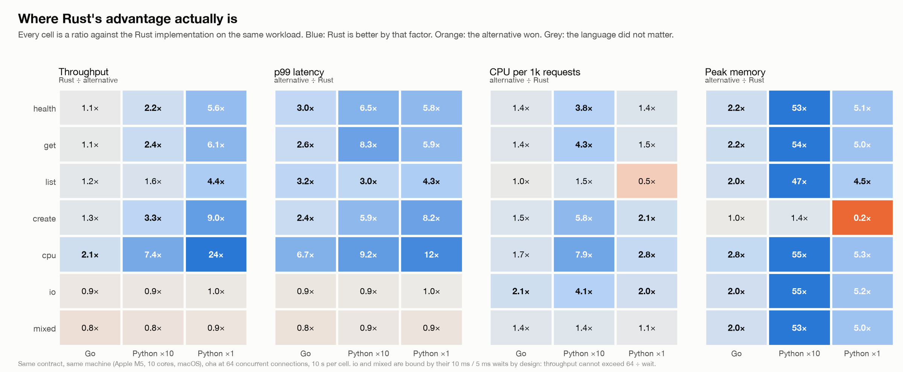
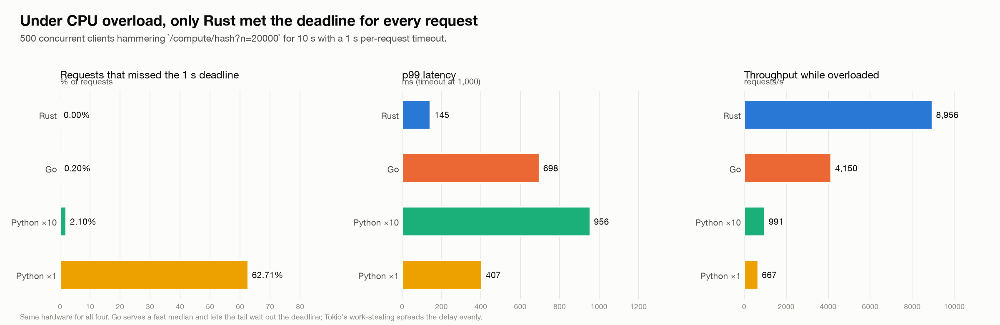
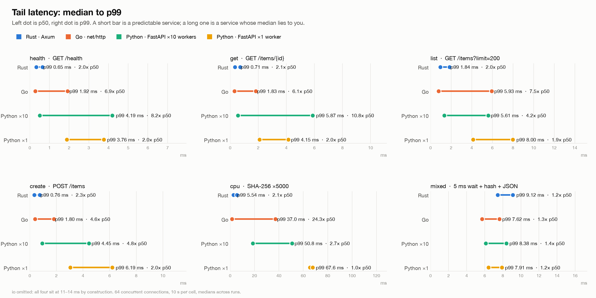
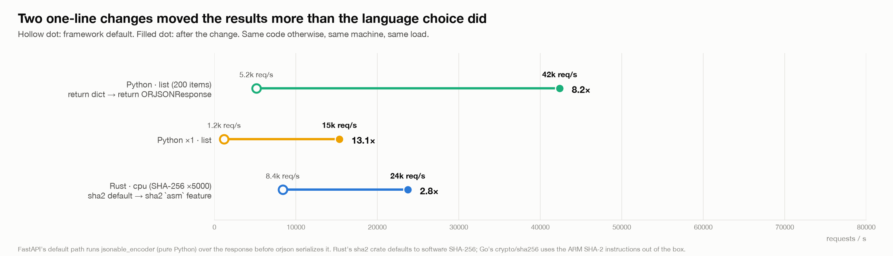

# X article

*Title:* Where Rust actually matters for an API service

*Cover image:* charts/00-social-card.png

---

"Rust is faster than Python" is true and useless. The questions worth answering are where, by how much, what it costs, and whether the thing your service does all day is one of the places where it matters.

So I built the same API three times, with each ecosystem's production stack: Rust with Axum on Tokio, Go with the standard library's net/http, and Python with FastAPI on Uvicorn (uvloop, httptools, orjson), run as ten workers and as one. Seven endpoints, each isolating one thing an API spends time on: the framework floor, a lookup, a 200-item list, a write, pure CPU, pure I/O wait, and a realistic mix. A shared contract test that refuses to benchmark anything that behaves differently. Hypotheses written down before the first run. Load from oha at 64 connections, 10 seconds per cell, on an Apple M5 with 10 cores. The load generator shares the machine, so read every number as relative.

## The one chart

Each cell is a ratio against Rust on the same workload. Blue: Rust is better by that factor. Orange: the alternative won. Grey: the language did not matter.

Read it by rows. The bottom two, where the request is waiting on something, are grey everywhere except the CPU and memory columns. The language does not decide how fast a waiting request goes. It decides what it costs while it waits.

## Where Rust wins

**CPU on the request path.** On 5,000 rounds of SHA-256 per request, Rust served 23.7k requests a second, Go 11.5k, ten-worker Python 3.2k. Past saturation it gets more interesting: with 500 concurrent clients and a 1-second timeout, Rust missed the deadline on zero requests with a p99 of 145 ms. Go missed 0.2% at 698 ms, ten-worker Python 2.1%, one-worker Python 63%. Go's median under overload actually beat Rust's, 21 ms to 51 ms, while its p99 was five times worse: Go's scheduler serves some requests fast and lets others wait out the deadline, Tokio's work-stealing spreads the delay evenly. If you have an SLO, evenly is what you want.

**Tail latency.** On a lookup, Rust's p99 is 0.71 ms and 2.1× its median. Go's is 1.83 ms at 6×. Ten-worker Python's is 5.87 ms at 11×. Under CPU load Go's p99 opens to 24× its median; Rust's stays at 2×. If your SLO is written against p99, Rust is the only one of the three whose tail stays flat.

**Density.** Per 1,000 lookups Rust spends 22 ms of CPU, Go 30, ten-worker Python 93. Idle memory is 9.9 MB, 13.5 MB and 710 MB. Across a fleet, that is the bill.

## Where it does not

On a 10 ms I/O wait, all four implementations land within 8% on throughput and within 1 ms on p99, and Rust is last: Tokio's sleep(10 ms) completes in 12.3 ms on this Mac even with one connection, while Go and uvloop take 11.3. Rust buys you 2 to 4× less CPU and 2 to 50× less memory while you wait. It does not buy you speed. Serialization is 1.2× Go and 1.6× tuned Python. And per idle connection Rust is the heaviest of the three, 31.6 KB against Go's 23 and Python's 18, because hyper buffers generously. My hypothesis had that order backwards.

## Two one-line changes

I kept the first run, with every framework at its defaults, in the repo on purpose. FastAPI returning a dict runs its pure-Python jsonable_encoder over the response before orjson serializes it; on 200 items that was 1.7 ms of CPU per request and a 14× gap to Rust. Returning ORJSONResponse directly took the gap to 1.6×. And Rust was slower than Go on hashing in the baseline, 8.4k against 14.7k, because Go's crypto/sha256 uses the ARM SHA-2 instructions out of the box and Rust's sha2 crate defaults to software. Its asm feature tripled throughput with an identical digest. The language sets the ceiling; the library decides whether you reach it.

## The finding that is not a benchmark number

Ten-worker Python has no shared memory. The contract test found it before the benchmark did: an item created on one Uvicorn worker is a 404 on the other nine. Python's only route to all ten cores is ten processes, which means ten copies of every in-memory structure and no shared state without Redis or a database round-trip that Rust and Go do not need for the same feature.

## What it costs

Rust and Go took the same number of lines, 177 and 182; Python 93. Rust ships 93 crates, Go zero, Python 21 packages. Clean build: 13.7 s for Rust, 3.2 s for Go. Cold start: 12 ms for both, 170 ms for one Python worker, 417 ms for ten. Go reaches within 10 to 25% of Rust on everything except CPU-bound work and tail latency, with zero dependencies and a 3-second build. It is the honest competitor here.

## So what should you pick

If you compute on the request path, Rust: 2× Go, 7× Python, and the only one that met the deadline for every request under overload. If your SLO is on p99, Rust. If you mostly wait on a database, the language does not decide your latency; pick for the team and pay the memory and CPU bill, about 2× for Go and 50× for ten-worker Python. If you need shared in-memory state across cores, Rust or Go. If you want most of Rust's density without its dependency graph, Go.

Caveats: one machine, load generator on the same cores, 10-second windows, macOS, an in-memory store, medians of four runs. Phase 2 is the same contract on PostgreSQL. Everything is open, including the raw oha output and the contract test: github.com/pradnyaw25/api-performance-lab. If a configuration is unfair to your favourite language, open an issue.
